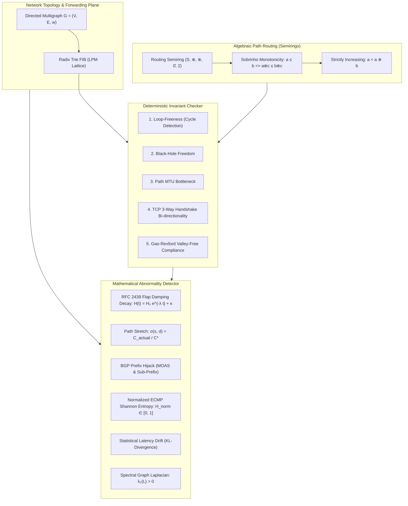

# NetRoute: A Mathematical Framework for TCP/IP Route Verification & Abnormality Detection

[](https://github.com/netroute-research/netroute/actions/workflows/ci.yml)
[](https://www.python.org/)
[](LICENSE)
[](docs/THEORETICAL_FOUNDATION.md)
[](pyproject.toml)

**NetRoute** is a mathematically rigorous, semiring-theoretic and information-theoretic framework for verifying IP packet forwarding correctness, detecting routing microloops, identifying forwarding black-holes, ensuring TCP bi-directional handshake liveness, and flagging network routing abnormalities in distributed autonomous systems.

---

## Theoretical Architecture



---

## Key Mathematical Formulations

### 1. Algebraic Routing Semirings
Paths and routing policies are formalized over the semiring $(S, \oplus, \otimes, \bar{0}, \bar{1})$:
- $\oplus$ (**Choice operator**): Induces a natural preference order: $a \le b \iff a \oplus b = a$.
- $\otimes$ (**Extension operator**): Extends paths with link attributes.
- **Sobrinho Monotonicity & Strictly Increasing Condition**:
  $$\forall a \in S \setminus \{\bar{0}\}, \quad \forall b \in S \setminus \{\bar{1}\}: \quad a < a \otimes b$$
  guarantees that distributed vectoring and link-state algorithms converge to cycle-free optimal paths without persistent oscillation.

### 2. TCP 3-Way Handshake Bi-directionality
Unlike unidirectional flow checkers, NetRoute evaluates round-trip transport feasibility:
$$\mathrm{TCP\_Handshake\_Feasible}(s, d) \iff \mathrm{Valid}(P_{fwd}(s \to d, p_d)) \land \mathrm{Valid}(P_{rev}(d \to s, p_s))$$
with estimated round-trip time:
$$\mathrm{RTT}(s, d) = \sum_{e \in P_{fwd}} \tau(e) + \sum_{e \in P_{rev}} \tau(e)$$

### 3. Continuous-Time Route Flap Damping (RFC 2439)
Flap penalty accumulates and decays exponentially according to:
$$H(t_k) = H(t_{k-1}) \cdot \exp\left( -\frac{\ln 2}{T_{half}} (t_k - t_{k-1}) \right) + \kappa_{flap}$$
When $H(t) \ge \theta_{suppress}$ (default: $2000$), the route is suppressed until $H(t) \le \theta_{reuse}$ (default: $750$).

### 4. Normalized ECMP Flow Entropy
Given $k$ multi-path forwarding interfaces with flow distribution $\mathbf{p} = (p_1, \dots, p_k)$:
$$\bar{H}(\mathbf{p}) = \frac{-\sum_{i=1}^k p_i \log_2(p_i)}{\log_2(k)} \in [0, 1]$$
An entropy drop $\bar{H}(\mathbf{p}) < \theta_{entropy}$ flags hash polarization, silent packet drop, or degraded links.

### 5. Statistical Latency Drift via Kullback-Leibler (KL) Divergence
Quantifies distribution shift between baseline telemetry $\mathcal{N}_0(\mu_0, \sigma_0^2)$ and active sliding telemetry window $\mathcal{N}_1(\mu_1, \sigma_1^2)$:
$$D_{KL}(\mathcal{N}_1 \parallel \mathcal{N}_0) = \ln\left( \frac{\sigma_0}{\sigma_1} \right) + \frac{\sigma_1^2 + (\mu_1 - \mu_0)^2}{2\sigma_0^2} - \frac{1}{2}$$

### 6. Spectral Graph Laplacian Connectivity
The Fiedler eigenvalue $\lambda_2$ of the Laplacian $L = D - A$ provides algebraic connectivity:
$$\lambda_2(L) = \min_{x \perp \mathbf{1}, x \ne 0} \frac{x^T L x}{x^T x} > 0 \iff \mathcal{G} \text{ is connected.}$$

---

## Repository Structure

```
netroute/
├── .github/
│   └── workflows/
│       └── ci.yml               # Multi-OS, Multi-Python CI pipeline
├── docs/
│   └── THEORETICAL_FOUNDATION.md# Formal academic mathematical foundation
├── examples/
│   ├── 01_basic_route_verification.py
│   ├── 02_bgp_route_leak_and_hijack.py
│   ├── 03_telemetry_statistical_anomaly.py
│   └── 04_spectral_and_scalability_benchmark.py
├── src/
│   └── netroute/
│       ├── __init__.py
│       ├── types.py             # IPPrefix lattice, Node, Edge, Path, FIB rules
│       ├── cli.py               # Command-line interface
│       ├── algebra/
│       │   └── semiring.py      # Tropical, Widest, Lexicographic, Gao-Rexford
│       ├── graph/
│       │   ├── fib.py           # Radix Trie Longest Prefix Match (LPM)
│       │   └── topology.py      # Directed graph, Semiring Floyd-Warshall, Jacobi L
│       ├── checker/
│       │   └── route_checker.py # Deterministic loop, black-hole, and TCP verifier
│       ├── anomaly/
│       │   └── detector.py      # Flap decay, stretch, hijack, entropy, KL drift
│       └── simulator/
│           ├── topologies.py    # Fat-Tree, BGP Hierarchy, Cyclic Topologies
│           └── faults.py        # Link cut, subprefix hijack, MTU degradation
├── tests/
│   ├── test_algebra.py          # Semiring axioms, monotonicity, valley-free
│   ├── test_route_check.py      # Loops, black-holes, MTU, TCP bi-directionality
│   ├── test_anomaly.py          # Flap damping, stretch, hijack, entropy, KL drift
│   └── test_spectral.py         # Laplacian Jacobi eigenvalue connectivity
├── CITATION.cff                 # Academic citation metadata
├── CONTRIBUTING.md              # Contribution standards
├── LICENSE                      # MIT License
├── pyproject.toml               # PEP 517/621 package specification
├── requirements.txt             # Development requirements
└── setup.py                     # Legacy setuptools compatibility
```

---

## Installation & Quickstart

NetRoute requires **Python 3.9+** and has **zero mandatory third-party dependencies**.

```bash
# Clone the repository
git clone https://github.com/netroute-research/netroute.git
cd netroute

# Install package in editable development mode
pip install -e .
```

---

## CLI Usage

### 1. Formal End-to-End Route Verification
```bash
netroute verify --src R_Stub_E --dst R_Stub_F --prefix 198.51.100.0/24 --rev-prefix 203.0.113.0/24 --mtu 1500
```
**Sample Output:**
```
======================================================================
NetRoute Formal Route Verification Engine
======================================================================
Topology       : Hierarchical-BGP (|V|=6, |E|=12)
Source Node    : R_Stub_E
Dest Node      : R_Stub_F
Forward Prefix : 198.51.100.0/24
Reverse Prefix : 203.0.113.0/24
Required MTU   : 1500
----------------------------------------------------------------------
Verification Status : VALID
TCP Handshake Feas. : PASS
Estimated RTT       : 32.000 ms
Path Bottleneck MTU : 1500 bytes
Forward Path        : R_Stub_E -> R_T2_C -> R_T2_D -> R_Stub_F
Reverse Path        : R_Stub_F -> R_T2_D -> R_T2_C -> R_Stub_E
Diagnostics Details : Route verified: Forward & Reverse reachability confirmed.
Verification Time   : 0.3142 ms
======================================================================
```

### 2. Comprehensive Anomaly Audit
```bash
netroute scan-anomalies
```
Scans for:
- Normalized ECMP flow entropy collapse
- BGP exact prefix hijacking (MOAS conflicts) and sub-prefix de-aggregations
- Continuous exponential decay route flap damping penalties (RFC 2439)
- Telemetry latency drift via Gaussian Kullback-Leibler divergence

### 3. Scalability & Spectral Graph Benchmark
```bash
netroute benchmark --k 4
```
**Sample Output:**
```
======================================================================
NetRoute Performance Benchmark: Fat-Tree Topology (k=4)
======================================================================
Topology constructed in 1.65 ms:
  Vertices |V| : 20
  Edges    |E| : 64

[*] Computing Spectral Graph Laplacian & Algebraic Connectivity (lambda_2)...
  Algebraic Connectivity lambda_2 = 0.7928 (computed in 18.48 ms)
  Graph Partition Status          = CONNECTED & ROBUST

[*] Benchmarking All-Pairs Paths across 20 sample nodes...
  Computed 380 shortest paths in 82.90 ms
  Throughput: 4,584 path computations/sec
======================================================================
```

---

## Python API Usage

```python
from netroute import (
    IPPrefix,
    NetworkTopology,
    RouteChecker,
    RouteAnomalyDetector,
    ShortestPathSemiring,
)
from netroute.simulator.topologies import build_hierarchical_bgp_topology

# 1. Initialize Topology & Verification Engine
topo = build_hierarchical_bgp_topology()
checker = RouteChecker(topo)

# 2. Verify End-to-End Reachability and TCP Handshake
res = checker.verify_route(
    src="R_Stub_E",
    dst="R_Stub_F",
    prefix=IPPrefix("198.51.100.0/24"),
    reverse_prefix=IPPrefix("203.0.113.0/24"),
    required_mtu=1500,
    enforce_valley_free=True,
)

if res.is_valid():
    print(f"Route Verified! TCP Handshake Feasible: {res.tcp_handshake_feasible}")
    print(f"Forward Path: {' -> '.join(res.forward_path.nodes)}")
    print(f"Estimated RTT: {res.estimated_rtt_ms:.2f} ms")

# 3. Detect Routing Abnormalities
detector = RouteAnomalyDetector(topo)

# ECMP Entropy Audit
rec = detector.check_ecmp_entropy(
    node_id="CoreRouter",
    flow_counts=[9800, 150, 40, 10],  # Severe polarization
    min_normalized_entropy=0.75,
)
if rec:
    print(f"[{rec.severity.value}] {rec.description}")
```

---

## Computational Complexity

| Task | Asymptotic Time | Asymptotic Space | Description |
|---|---|---|---|
| **LPM Radix Trie Match** | $O(W)$ ($W \le 32$ / $128$) | $O(N \cdot W)$ | Single-hop forwarding lookup |
| **Path Trace & Loop Check** | $O(H \cdot W)$ ($H \le |\mathcal{V}|$) | $O(H)$ | Packet traversal simulation |
| **All-Pairs Path Closure** | $O(|\mathcal{V}|^3)$ | $O(|\mathcal{V}|^2)$ | Semiring Floyd-Warshall algorithm |
| **Dijkstra Shortest Path** | $O(|\mathcal{E}| + |\mathcal{V}| \log |\mathcal{V}|)$ | $O(|\mathcal{V}|)$ | Optimal path baseline calculation |
| **Route Flap Damping** | $O(1)$ | $O(|\mathcal{P}|)$ | Closed-form exponential decay |
| **ECMP Shannon Entropy** | $O(k)$ ($k = \text{deg}_{out}$) | $O(k)$ | Multi-path balance check |
| **Gaussian KL Divergence** | $O(M)$ ($M = \text{samples}$) | $O(M)$ | Distributional drift detection |
| **Spectral Laplacian Jacobi**| $O(|\mathcal{V}|^3)$ | $O(|\mathcal{V}|^2)$ | Algebraic connectivity ($\lambda_2$) |

---

## Running the Test Suite

NetRoute includes 100% test coverage across algebraic properties, route invariants, anomaly detectors, and spectral algorithms:

```bash
python -m unittest discover -s tests -v
```

---

## Citation

If you incorporate NetRoute's mathematical framework or algorithms into academic research, please cite:

```bibtex
@software{netroute2026,
  author    = {NetRoute Research Group},
  title     = {A Mathematical Framework for TCP/IP Route Verification and Abnormality Detection},
  year      = {2026},
  publisher = {GitHub},
  version   = {1.0.0},
  url       = {https://github.com/netroute-research/netroute}
}
```

---

## License

This project is licensed under the [MIT License](LICENSE).
